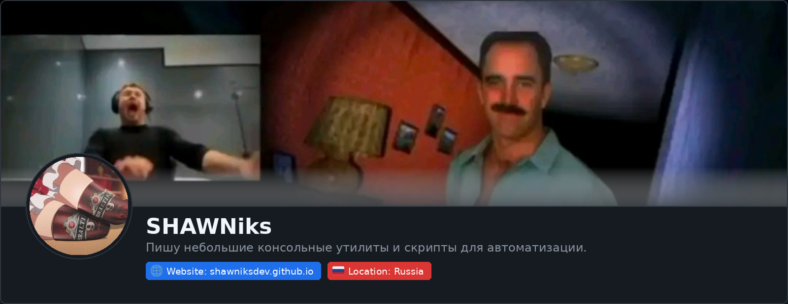
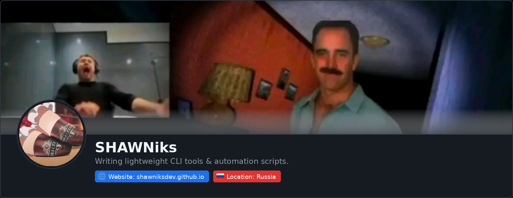

  
  

  

 

### ИНСТРУМЕНТЫ

  
  
  
  
  

---

### ИЗБРАННЫЙ ПРОЕКТ

* **[kodikdown](https://github.com/SHAWNiksDev/kodikdown)** — Программа/консольная утилита для скачивания видео с плеера Kodik.

 

  

---

  
<b>🇬🇧 English version / Switch to English</b>

   

  

    
  

   

  ### TOOLS

  

    
    
    
    
    
  

  ---

  ### FEATURED PROJECT

  * **[kodikdown](https://github.com/SHAWNiksDev/kodikdown)** — Software / CLI tool for downloading videos from the Kodik player.

   

  

    
  

